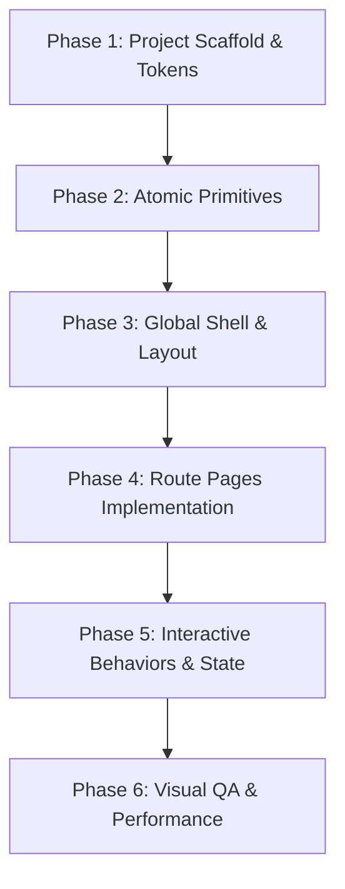

# Prioritized Implementation Plan

This roadmap provides a phased engineering plan to rebuild the **camelAI** website independently with 1:1 visual, structural, and behavioral fidelity.



---

## Phase 1: Project Scaffold & Design System Tokens

**Goal**: Initialize modern frontend project structure, configure webfonts, and bind exact CSS custom properties.

### Tasks:
1. **Initialize Project Repository**:
   - Create workspace with **React Router v7** or **Vite + React 19** + **TypeScript**.
   - Install dependencies:
     ```bash
     npm install lucide-react @radix-ui/react-navigation-menu @radix-ui/react-collapsible @radix-ui/react-slot class-variance-authority clsx tailwind-merge
     npm install -D tailwindcss @tailwindcss/vite
     ```
2. **Typography Configuration**:
   - Embed Google Fonts via `<link>` in `root.html` / `index.html`:
     - `Figtree` (300..900)
     - `Geist Mono` (100..900)
     - `Silkscreen` (400, 700)
     - `Source Serif 4` (200..900)
   - Copy `camelCoolFont-Regular.woff2` to `/public/fonts/` and configure `@font-face` in global CSS.
3. **CSS Design Tokens**:
   - Create `src/styles/globals.css` with exact `:root` and `.dark` variables documented in [design-system.md](file:///c:/Users/HP/Desktop/clev/analysis/design-system.md).
   - Enforce `--radius: 0rem` and brutalist zero-radius utility overrides.

---

## Phase 2: Core Atoms & UI Primitives

**Goal**: Build isolated, reusable component building blocks.

### Tasks:
1. **`lib/utils.ts`**:
   - Export standard `cn(...inputs)` helper combining `clsx` and `twMerge`.
2. **`PixelButton` (`components/ui/PixelButton.tsx`)**:
   - Implement `primary`, `secondary`, and `ghost` variants.
   - Bind `font-silkscreen`, `text-[11px]`, uppercase, and `tracking-[0.22em]`.
   - Support both `<button>` and `<a>` modes via `href`.
3. **`Button` (`components/ui/Button.tsx`)**:
   - Implement CVA variants (`default`, `outline`, `secondary`, `ghost`, `destructive`, `link`).
   - Implement size matrix (`default`, `xs`, `sm`, `lg`, `icon*`).
   - Wire Radix `Slot` for `asChild` support.
4. **`Eyebrow` (`components/ui/Eyebrow.tsx`)**:
   - Implement uppercase pixel badge with `text-[10px]` and `tracking-[0.3em]`.
5. **`Collapsible` (`components/ui/Collapsible.tsx`)**:
   - Wrap `@radix-ui/react-collapsible` and add keyframe animations (`collapsible-down`, `collapsible-up`).
6. **`Separator` (`components/ui/Separator.tsx`)**:
   - Horizontal and vertical rule primitives.

---

## Phase 3: Global Shell & Layout Components

**Goal**: Implement the responsive header, navigation menu, and footer.

### Tasks:
1. **`Navbar` (`components/layout/Navbar.tsx`)**:
   - Sticky blur container (`sticky top-0 z-50 bg-background/80 backdrop-blur-xl border-b border-border/50`).
   - Dual logo SVG embedding (`logo-light.svg` / `logo-dark.svg`) with dark mode class swapping.
   - Integrate Radix `NavigationMenu` with BOT, RUN, and CODE dropdown menus.
   - Desktop PRICING, BLOG, and CONTACT links.
   - Header action group (LOG IN and START FREE buttons).
2. **`MobileDrawer` (`components/layout/MobileDrawer.tsx`)**:
   - Responsive hamburger button toggle.
   - Sliding full-screen overlay for viewports `< 1024px`.
   - Focus trapping and body scroll locking.
3. **`Footer` (`components/layout/Footer.tsx`)**:
   - Multi-column link directory (Products, Resources, Company, Legal).
   - Inline SVG social icons (X, LinkedIn, YouTube, GitHub, Discord).
   - Copyright notice and status indicator.
4. **`RootLayout`**:
   - Mount global Navbar, `<main>` outlet, and Footer.
   - Initialize `useDarkMode` theme detection hook.

---

## Phase 4: Route-by-Route Page Reconstruction

**Goal**: Build out complete page layouts and section organisms.

### Tasks:
1. **Homepage (`/`)**:
   - **`HeroSection`**: Fluid clamp H1 typography, dynamic SVH calculation, CTA buttons, and product row grid.
   - **`BotSection`**: Discord bot prompt input, category selector, and simulated Discord chat window.
   - **`RunSection`**: Serverless runtime explanation, $0.01/hr badge, and SDK code snippet.
   - **`CodeSection`**: Persistent computer value proposition, terminal preview, and app carousel.
   - **`PlatformSection`**: Architecture diagram illustrating how camelRun powers camelBot and camelCode.
   - **`FAQSection`**: 8-item accordion answering core product, pricing, and open-source questions.
   - **`CompanySection`**: Founder avatars, YC W24 badge, and company mission statement.
2. **Pricing Page (`/pricing`)**:
   - Implement 3-column product pricing matrix (camelBot, camelRun, camelCode).
   - Detailed cost breakdown tables (compute, storage, model tokens, web search).
   - Free vs. paid tier comparisons and billing FAQ.
3. **Product Landing Pages**:
   - `/bot` & `/discord`: Detailed Discord bot builder features, use cases, and template catalog.
   - `/code`: camelCode assistant capabilities, permanent computer sandbox, and BYO API key options.
   - `/run`: Serverless agent hosting, wake-up triggers, crons, webhooks, and architecture comparison vs AWS/OpenAI.
4. **Secondary & Support Pages**:
   - `/about-us`: Full company story, founder bios, and career links.
   - `/contact`: Responsive sales contact form.
   - `/open-source`: Self-hosting guide, Docker instructions, and MIT license terms.
   - `/blog`: Blog listing with category filters and article cards.
   - `/legal` & `/privacy-policy`: Structured terms and privacy policy documents.

---

## Phase 5: Client Interactivity & State Management

**Goal**: Implement client-side state, transitions, and mock telemetry.

### Tasks:
1. **Interactive Prompt Picker**:
   - Wire state between category preset pills and prompt input.
   - Live-update Discord preview message text and bot responses.
2. **Navigation Dropdown Animations**:
   - Configure entering/exiting transitions with `cubic-bezier(0.22, 1, 0.36, 1)`.
   - Chevron 180° rotation on open.
3. **Dark Mode Integration**:
   - Support system preference (`prefers-color-scheme`) with optional manual toggle.
4. **Telemetry & Journey Mock Handler**:
   - Create mock API endpoint `POST /api/journey/events` returning HTTP 200 to consume attribution events gracefully.

---

## Phase 6: Visual QA & Performance Verification

**Goal**: Verify 1:1 visual parity against captured baseline artifacts and optimize performance.

### Tasks:
1. **Screenshot Visual Comparison**:
   - Compare rendered output against captured baselines:
     - Desktop: `analysis/screenshots/landing-desktop-1280.png`
     - Tablet: `analysis/screenshots/landing-tablet-768.png`
     - Mobile: `analysis/screenshots/landing-mobile-375.png`
     - Dropdown: `analysis/screenshots/bot-menu-open.png`
     - Pricing: `analysis/screenshots/pricing-desktop-1440.png`
2. **Responsive Verification**:
   - Verify layout integrity at 375px (mobile), 768px (tablet), and 1280px+ (desktop).
3. **Lighthouse Audit**:
   - Verify 95+ score on Performance, Accessibility, Best Practices, and SEO.
   - Ensure zero layout shift (CLS < 0.05) through font preloading and dimensioned images.
