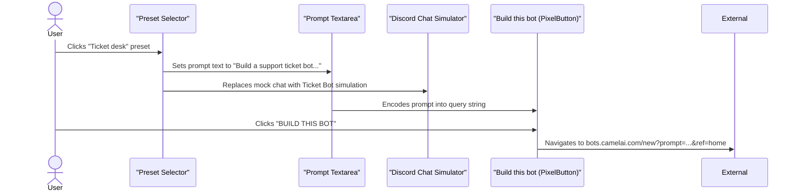

# Interaction & Behavioral Specifications

## 1. Desktop Navigation Dropdown Menus

The top navigation uses **`@radix-ui/react-navigation-menu`** configured in non-viewport floating mode (`data-viewport="false"`).

### 1.1 Trigger & State Transitions
- **Triggers**: `"BOT"`, `"RUN"`, `"CODE"`.
- **States**:
  - `data-state="closed"` (Default): Hidden, chevron at 0° rotation.
  - `data-state="open"`: Popover visible, chevron rotated 180°.
- **Trigger CSS**:
  ```css
  .navigation-menu-trigger {
    font-family: Silkscreen, monospace;
    font-size: 10px;
    letter-spacing: 0.18em;
    text-transform: uppercase;
    background: transparent;
    padding: 0.5rem 0.5rem;
    color: var(--muted-foreground);
    transition: color 150ms ease;
  }
  .navigation-menu-trigger:hover,
  .navigation-menu-trigger[data-state="open"] {
    color: var(--foreground);
    background: transparent;
  }
  ```
- **Chevron Rotation**:
  ```css
  svg.lucide-chevron-down {
    transition: transform 300ms cubic-bezier(0.22, 1, 0.36, 1);
  }
  [data-state="open"] > svg.lucide-chevron-down {
    transform: rotate(180deg);
  }
  ```
- **Content Popover Animation**:
  - Top position: `top: calc(100% + 0.375rem)`
  - Entering: `duration-300 animate-in fade-in-0 zoom-in-95 ease-[cubic-bezier(0.22,1,0.36,1)]`
  - Exiting: `animate-out fade-out-0 zoom-out-95`
  - Dimensions: Fixed width `w-80` (`20rem` / `320px`), padding `p-2`.

---

## 2. Mobile Drawer Navigation

When the viewport is narrower than `1024px` (`< lg`):
1. **Trigger**: An icon button displaying `<Menu className="size-6" />` (`aria-label="Open navigation"`).
2. **Backdrop & Drawer**:
   - A full-screen backdrop overlay fades in (`bg-background/95 backdrop-blur-md`).
   - The navigation link hierarchy slides down from the navbar.
3. **Scroll Lock**: The document root `body` receives `overflow: hidden` to prevent background scrolling during menu interaction.
4. **Close Triggers**: Clicking any navigation link or pressing `Escape` closes the drawer.

---

## 3. Bot Prompt Interactive Sandbox (`#bot`)

The `#bot` section features a live interactive simulation where visitors can preview bot behavior before jumping to the Discord builder.



### 3.1 Presets Data Model
```typescript
interface BotPreset {
  key: string;
  label: string;
  prompt: string;
  useCase: string;
  mockMessages: Array<{
    author: string;
    isBot: boolean;
    content: string;
    timestamp: string;
  }>;
}
```

---

## 4. FAQ Accordion (`#faq`)

- **Root Component**: `@radix-ui/react-collapsible` or `@radix-ui/react-accordion`.
- **Expansion Behavior**: Single item expanded at a time (`type="single" collapsible`).
- **Interactive State**:
  - `data-state="closed"`: Question row bordered, icon indicates `+` or chevron down.
  - `data-state="open"`: Question text highlighted in bold/foreground, icon rotates, answer container expands smoothly using CSS height transitions.
- **Answer Animation**:
  ```css
  [data-slot="collapsible-content"][data-state="open"] {
    animation: collapsible-down 250ms cubic-bezier(0.87, 0, 0.13, 1);
  }
  [data-slot="collapsible-content"][data-state="closed"] {
    animation: collapsible-up 200ms cubic-bezier(0.87, 0, 0.13, 1);
  }
  ```

---

## 5. Dark Mode / Theme State Management

Observed directly from `use-dark-mode-Bz5XUOL5.js`:

```typescript
import { useState, useEffect } from "react";

export function useDarkMode(): boolean {
  const [isDark, setIsDark] = useState<boolean>(false);

  useEffect(() => {
    const mediaQuery = window.matchMedia("(prefers-color-scheme: dark)");
    setIsDark(mediaQuery.matches);

    const handler = (event: MediaQueryListEvent) => setIsDark(event.matches);
    mediaQuery.addEventListener("change", handler);
    return () => mediaQuery.removeEventListener("change", handler);
  }, []);

  return isDark;
}
```

### Theme Class Toggling & Asset Swapping
- The `.dark` class on `document.documentElement` controls CSS variables.
- Logo assets swap via CSS utility classes without layout shift:
  - ``
  - ``

---

## 6. Marketing Journey Tracking & Attribution

All interactive buttons and navigation links contain metadata attributes for user funnel attribution:
- `data-journey-cta="primary | secondary | bot-overview | open-builder"`
- `data-journey-location="hero | nav | footer | pricing"`

### Client-side Telemetry Call
When key CTAs are clicked, a beacon event is dispatched:
```typescript
fetch("/api/journey/events", {
  method: "POST",
  headers: { "Content-Type": "application/json" },
  body: JSON.stringify({
    event: "cta_click",
    cta: target.getAttribute("data-journey-cta"),
    location: target.getAttribute("data-journey-location"),
    destination: target.getAttribute("href"),
    timestamp: Date.now()
  }),
  keepalive: true
});
```

---

## 7. Error Handling, Loading & Empty States

### 7.1 Global Error Boundary (`error-page-OpCZBZlY.js`)
If an uncaught runtime error or broken route occurs:
- Renders an ASCII art header in `font-silkscreen`.
- Error code (e.g., `404 - NOT FOUND` or `500 - APPLICATION ERROR`).
- Helpful recovery options:
  - `PixelButton` returning to Home (`/`).
  - Link to GitHub issues (`https://github.com/qaml-ai/camelAI/issues`).
  - Discord support server invite (`https://discord.gg/7aMc7s9V3h`).

### 7.2 Lazy Route Loading State
During asynchronous route chunk fetching, the browser keeps the existing page active, displaying a top-level progress bar or minimal pixel loading indicator before mounting the incoming view.
